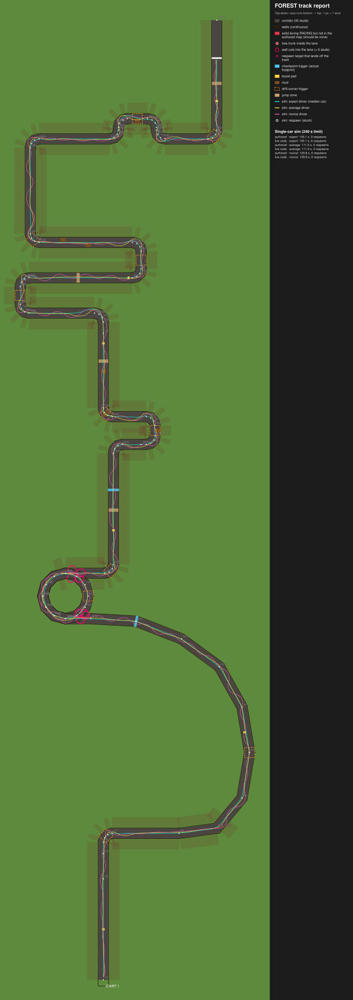

# FOREST track report

Generated by `lune run tools/report.luau` from the real map builder, game modules and server scripts running in the offline mock engine. Re-run it after every map or balance change.

## Single-car race simulation

Each car drives alone with the shared Autopilot. "Authored" restores every part's authored collision. "Live code" runs MapVisibility and RaceProgress exactly as the server does; the two should match.

| Map | Car | Top speed | Driver | Result | Respawns | Wall hits |
|---|---|---|---|---|---|---|
| authored | slowest | 68.0 | expert | 107.2 s | 0 | 0 |
| live code | slowest | 68.0 | expert | 107.2 s | 0 | 0 |
| authored | slowest | 68.0 | average | 112.8 s | 0 | 6 |
| live code | slowest | 68.0 | average | 112.8 s | 0 | 6 |
| authored | slowest | 68.0 | novice | 129.0 s | 0 | 18 |
| live code | slowest | 68.0 | novice | 129.0 s | 0 | 18 |
| authored | p50 | 68.7 | expert | 105.1 s | 0 | 1 |
| live code | p50 | 68.7 | expert | 105.1 s | 0 | 1 |
| authored | p50 | 68.7 | average | 111.0 s | 0 | 5 |
| live code | p50 | 68.7 | average | 111.0 s | 0 | 5 |
| authored | p50 | 68.7 | novice | 129.8 s | 0 | 30 |
| live code | p50 | 68.7 | novice | 129.8 s | 0 | 30 |
| authored | fastest | 70.0 | expert | 102.4 s | 0 | 0 |
| live code | fastest | 70.0 | expert | 102.4 s | 0 | 0 |
| authored | fastest | 70.0 | average | 108.5 s | 0 | 9 |
| live code | fastest | 70.0 | average | 108.5 s | 0 | 9 |
| authored | fastest | 70.0 | novice | 125.3 s | 0 | 23 |
| live code | fastest | 70.0 | novice | 125.3 s | 0 | 23 |

Cars by top speed: slowest = Microwave + Magnifying Glass + Toilet Paper (top speed 68.0, turn 2.24 rad/s); p50 = Washing Machine + Fire Extinguisher + Watermelon + Alarm Clock (top speed 68.7, turn 2.39 rad/s); fastest = Trash Can + Rocket + Gas Can + Log (top speed 70.0, turn 2.50 rad/s).

## Simulated matches (12 × 6 bots, authored map)

- Finish rate within 240 s: 100%
- Fastest car won 1 of 12 matches that had a finisher
- Rank correlation, top speed vs place: -0.13 (−1 = faster always places better)
- Rank correlation, rarity points collected vs place: -0.29

| Group | Mean place (1 = best) |
|---|---|
| farming: sweaty | 3.36 |
| farming: casual | 3.64 |
| driving: expert | 1.50 |
| driving: average | 3.50 |
| driving: novice | 5.50 |

## Fun metrics

Each simulated match is scored with `Shared/RaceMetrics` (the same code scores real Studio playtests, see `Modules/PlaytestReport`). Bots race as ghosts on one clock: no car-to-car contact, no abilities, so lead changes come from build and driving differences only. Targets are starting points in `Constants.FUN_TARGETS`; playtests decide.

| | Metric | Value | Target | Why |
|---|---|---|---|---|
| ✓ | closeShare | 0.45 | 0.25 ..  | the top two race each other a quarter of the time |
| ✓ | fastestWinRate | 0.08 |  .. 0.70 | the fastest build should not always win |
| ✓ | finishRate | 1.00 | 0.90 ..  | almost everyone finishes |
| ✓ | finishSpread | 24.91 |  .. 45.00 | nobody waits long for the last car |
| ✓ | leadChanges | 2.42 | 1.00 ..  | the lead changes at least once |
| ✗ | racingShare | 0.35 | 0.35 ..  | share of a round spent racing (vs farming / crafting / results) |
| ✓ | speedPlaceCorr | -0.13 | -0.60 .. 0.10 | the build helps a little; it must not decide the race |
| ✓ | winnerTime | 104.25 | 60.00 .. 120.00 | a race should take about 90 s |

Overtakes per match: 13.2. Per section (mean over matches; "decided" = matches whose largest time spread between bots was in that section):

| Section | Mean time (s) | Spread between bots (s) | Decided | Respawns | Wall hits |
|---|---|---|---|---|---|
| S1 start straight | 6.3 | 1.4 | 0 | 0 | 1 |
| S2 outcrop corner | 9.0 | 1.2 | 0 | 0 | 19 |
| S3 trestle climb | 20.0 | 2.0 | 0 | 0 | 63 |
| S4 giant tree spiral | 11.9 | 3.4 | 0 | 0 | 120 |
| S4b tree run-out | 10.0 | 3.1 | 0 | 0 | 78 |
| S5 mud hook | 10.7 | 3.9 | 0 | 0 | 101 |
| S6 pine switchbacks | 24.1 | 7.4 | 8 | 0 | 320 |
| S7 ridge chicane | 22.3 | 7.0 | 4 | 0 | 282 |

## Geometry findings

- 0 parts inside or next to the lane are solid during RACING but not in the authored map (red boxes).
- 0 decoration parts (Trunk) stand inside the lane (red dots).
- 8 spots where a wall cuts more than 6 studs into the lane (pink rings).
- 0 of 158 sampled positions respawn off the track (pink ×).

## Known bugs from the test suite (0)

## What this does not cover

- Real Roblox physics: jumps, ramps, impulses, car-to-car contact. Confirm with the Studio RaceSim (`TestHarness.Runner.runRace`).
- Network latency, touch controls and whether it is fun. Those need people.
