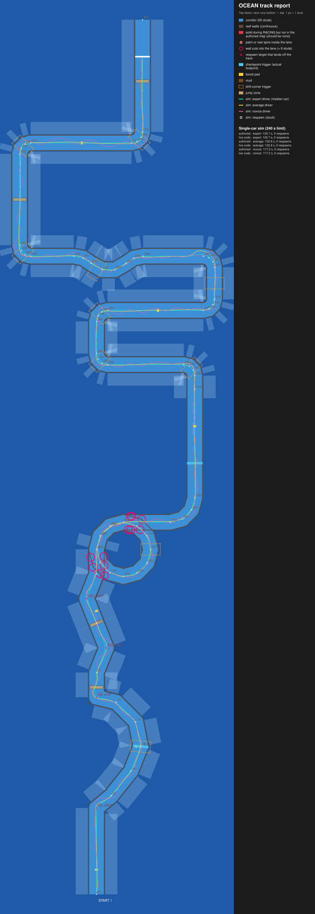

# OCEAN track report

Generated by `lune run tools/report.luau` from the real map builder, game modules and server scripts running in the offline mock engine. Re-run it after every map or balance change.

## Single-car race simulation

Each car drives alone with the shared Autopilot. "Authored" restores every part's authored collision. "Live code" runs MapVisibility and RaceProgress exactly as the server does; the two should match.

| Map | Car | Top speed | Driver | Result | Respawns | Wall hits |
|---|---|---|---|---|---|---|
| authored | slowest | 33.2 | expert | 164.0 s | 0 | 0 |
| live code | slowest | 33.2 | expert | 164.0 s | 0 | 0 |
| authored | slowest | 33.2 | average | 168.9 s | 0 | 0 |
| live code | slowest | 33.2 | average | 168.9 s | 0 | 0 |
| authored | slowest | 33.2 | novice | 179.1 s | 0 | 0 |
| live code | slowest | 33.2 | novice | 179.1 s | 0 | 0 |
| authored | p50 | 52.2 | expert | 111.6 s | 0 | 0 |
| live code | p50 | 52.2 | expert | 111.6 s | 0 | 0 |
| authored | p50 | 52.2 | average | 116.4 s | 0 | 0 |
| live code | p50 | 52.2 | average | 116.4 s | 0 | 0 |
| authored | p50 | 52.2 | novice | 131.3 s | 0 | 1 |
| live code | p50 | 52.2 | novice | 131.3 s | 0 | 1 |
| authored | fastest | 80.0 | expert | 70.8 s | 0 | 0 |
| live code | fastest | 80.0 | expert | 70.8 s | 0 | 0 |
| authored | fastest | 80.0 | average | 76.0 s | 0 | 0 |
| live code | fastest | 80.0 | average | 76.0 s | 0 | 0 |
| authored | fastest | 80.0 | novice | 99.7 s | 0 | 4 |
| live code | fastest | 80.0 | novice | 99.7 s | 0 | 4 |

Cars by top speed: slowest = Microwave + Fan + Balloon Bunch (top speed 33.2, turn 1.22 rad/s); p50 = Skateboard + Magnifying Glass + Cactus (top speed 52.2, turn 1.26 rad/s); fastest = Kite + Fan + Magnet + Bathtub (top speed 80.0, turn 2.00 rad/s).

## Simulated matches (12 × 6 bots, authored map)

- Finish rate within 240 s: 100%
- Fastest car won 6 of 12 matches that had a finisher
- Rank correlation, top speed vs place: -0.72 (−1 = faster always places better)
- Rank correlation, rarity points collected vs place: -0.49

| Group | Mean place (1 = best) |
|---|---|
| farming: sweaty | 2.61 |
| farming: casual | 4.39 |
| driving: expert | 2.92 |
| driving: average | 2.67 |
| driving: novice | 4.92 |

## Fun metrics

Each simulated match is scored with `Shared/RaceMetrics` (the same code scores real Studio playtests, see `Modules/PlaytestReport`). Bots race as ghosts on one clock: no car-to-car contact, no abilities, so lead changes come from build and driving differences only. Targets are starting points in `Constants.FUN_TARGETS`; playtests decide.

| | Metric | Value | Target | Why |
|---|---|---|---|---|
| ✗ | closeShare | 0.12 | 0.25 ..  | the top two race each other a quarter of the time |
| ✓ | fastestWinRate | 0.50 |  .. 0.70 | the fastest build should not always win |
| ✓ | finishRate | 1.00 | 0.90 ..  | almost everyone finishes |
| ✗ | finishSpread | 50.61 |  .. 45.00 | nobody waits long for the last car |
| ✓ | leadChanges | 1.50 | 1.00 ..  | the lead changes at least once |
| ✗ | racingShare | 0.35 | 0.35 ..  | share of a round spent racing (vs farming / crafting / results) |
| ✓ | speedPlaceCorr | -0.72 | -0.85 .. -0.30 | a better build helps, but driving and items matter too |
| ✓ | winnerTime | 76.00 | 60.00 .. 120.00 | a race should take about 90 s |

Overtakes per match: 10.5. Per section (mean over matches; "decided" = matches whose largest time spread between bots was in that section):

| Section | Mean time (s) | Spread between bots (s) | Decided | Respawns | Wall hits |
|---|---|---|---|---|---|
| S1 harbor launch | 5.6 | 2.8 | 0 | 0 | 0 |
| S2 island arc | 10.2 | 5.6 | 0 | 0 | 8 |
| S3 open channel | 9.4 | 4.9 | 0 | 0 | 11 |
| S4 reef U-bend | 14.2 | 8.3 | 0 | 0 | 21 |
| S5 return channel | 20.5 | 12.0 | 8 | 0 | 48 |
| S6 reef hairpin | 19.0 | 10.4 | 1 | 0 | 14 |
| S7 kelp channel | 22.0 | 10.9 | 3 | 0 | 0 |

## Geometry findings

- 0 parts inside or next to the lane are solid during RACING but not in the authored map (red boxes).
- 0 decoration parts (^PalmTrunk$, ^ReefSpire_%d+$) stand inside the lane (red dots).
- 0 spots where a wall cuts more than 6 studs into the lane (pink rings).
- 0 of 119 sampled positions respawn off the track (pink ×).

## Known bugs from the test suite (1)

- **audio › every sound has an asset id** — BGM and ambience ids in SoundConfig are still empty placeholders

## What this does not cover

- Real Roblox physics: jumps, ramps, impulses, car-to-car contact. Confirm with the Studio RaceSim (`TestHarness.Runner.runRace`).
- Network latency, touch controls and whether it is fun. Those need people.
