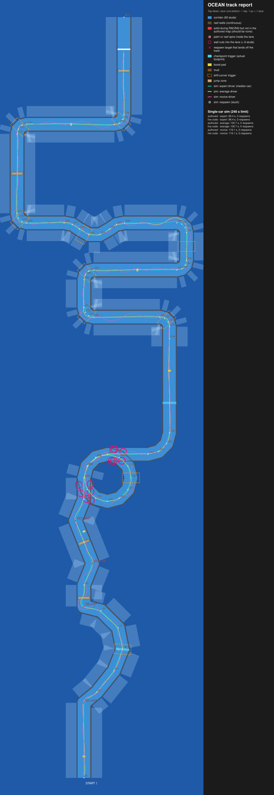

# OCEAN track report

Generated by `lune run tools/report.luau` from the real map builder, game modules and server scripts running in the offline mock engine. Re-run it after every map or balance change.

## Single-car race simulation

Each car drives alone with the shared Autopilot. "Authored" restores every part's authored collision. "Live code" runs MapVisibility and RaceProgress exactly as the server does; the two should match.

| Map | Car | Top speed | Driver | Result | Respawns | Wall hits |
|---|---|---|---|---|---|---|
| authored | slowest | 62.1 | expert | 101.1 s | 0 | 0 |
| live code | slowest | 62.1 | expert | 101.1 s | 0 | 0 |
| authored | slowest | 62.1 | average | 103.0 s | 0 | 0 |
| live code | slowest | 62.1 | average | 103.0 s | 0 | 0 |
| authored | slowest | 62.1 | novice | 114.0 s | 0 | 0 |
| live code | slowest | 62.1 | novice | 114.0 s | 0 | 0 |
| authored | p50 | 62.5 | expert | 98.4 s | 0 | 0 |
| live code | p50 | 62.5 | expert | 98.4 s | 0 | 0 |
| authored | p50 | 62.5 | average | 100.7 s | 0 | 0 |
| live code | p50 | 62.5 | average | 100.7 s | 0 | 0 |
| authored | p50 | 62.5 | novice | 116.1 s | 0 | 1 |
| live code | p50 | 62.5 | novice | 116.1 s | 0 | 1 |
| authored | fastest | 63.9 | expert | 97.5 s | 0 | 0 |
| live code | fastest | 63.9 | expert | 97.5 s | 0 | 0 |
| authored | fastest | 63.9 | average | 99.3 s | 0 | 0 |
| live code | fastest | 63.9 | average | 99.3 s | 0 | 0 |
| authored | fastest | 63.9 | novice | 114.0 s | 0 | 1 |
| live code | fastest | 63.9 | novice | 114.0 s | 0 | 1 |

Cars by top speed: slowest = Microwave + Electric Guitar + Rubber Duck (top speed 62.1, turn 1.52 rad/s); p50 = Bicycle + Fire Extinguisher + Soda Bottle (top speed 62.5, turn 1.53 rad/s); fastest = Kite + Fire Extinguisher + Umbrella + Bathtub (top speed 63.9, turn 1.77 rad/s).

## Simulated matches (12 × 6 bots, authored map)

- Finish rate within 240 s: 100%
- Fastest car won 5 of 12 matches that had a finisher
- Rank correlation, top speed vs place: -0.26 (−1 = faster always places better)
- Rank correlation, rarity points collected vs place: -0.42

| Group | Mean place (1 = best) |
|---|---|
| farming: sweaty | 3.28 |
| farming: casual | 3.72 |
| driving: expert | 1.71 |
| driving: average | 3.29 |
| driving: novice | 5.50 |

## Fun metrics

Each simulated match is scored with `Shared/RaceMetrics` (the same code scores real Studio playtests, see `Modules/PlaytestReport`). Bots race as ghosts on one clock: no car-to-car contact, no abilities, so lead changes come from build and driving differences only. Targets are starting points in `Constants.FUN_TARGETS`; playtests decide.

| | Metric | Value | Target | Why |
|---|---|---|---|---|
| ✓ | closeShare | 0.67 | 0.25 ..  | the top two race each other a quarter of the time |
| ✓ | fastestWinRate | 0.42 |  .. 0.70 | the fastest build should not always win |
| ✓ | finishRate | 1.00 | 0.90 ..  | almost everyone finishes |
| ✓ | finishSpread | 14.63 |  .. 45.00 | nobody waits long for the last car |
| ✓ | leadChanges | 2.08 | 1.00 ..  | the lead changes at least once |
| ✗ | racingShare | 0.32 | 0.35 ..  | share of a round spent racing (vs farming / crafting / results) |
| ✓ | speedPlaceCorr | -0.26 | -0.60 .. 0.10 | the build helps a little; it must not decide the race |
| ✓ | winnerTime | 99.34 | 60.00 .. 120.00 | a race should take about 90 s |

Overtakes per match: 12.8. Per section (mean over matches; "decided" = matches whose largest time spread between bots was in that section):

| Section | Mean time (s) | Spread between bots (s) | Decided | Respawns | Wall hits |
|---|---|---|---|---|---|
| S1 harbor launch | 6.2 | 1.1 | 0 | 0 | 0 |
| S2 island arc | 10.2 | 1.8 | 0 | 0 | 1 |
| S3 open channel | 9.1 | 2.1 | 0 | 0 | 3 |
| S3b to the lighthouse | 1.6 | 0.1 | 0 | 0 | 0 |
| S4 lighthouse spiral | 13.8 | 1.4 | 0 | 0 | 0 |
| S5 water slide | 19.7 | 3.0 | 1 | 0 | 15 |
| S6 reef hairpin | 21.7 | 4.2 | 7 | 0 | 20 |
| S7 kelp channel | 22.2 | 3.9 | 4 | 0 | 12 |

## Geometry findings

- 0 parts inside or next to the lane are solid during RACING but not in the authored map (red boxes).
- 0 decoration parts (^PalmTrunk$, ^ReefSpire_%d+$) stand inside the lane (red dots).
- 12 spots where a wall cuts more than 6 studs into the lane (pink rings).
- 0 of 136 sampled positions respawn off the track (pink ×).

## Known bugs from the test suite (0)

## What this does not cover

- Real Roblox physics: jumps, ramps, impulses, car-to-car contact. Confirm with the Studio RaceSim (`TestHarness.Runner.runRace`).
- Network latency, touch controls and whether it is fun. Those need people.
