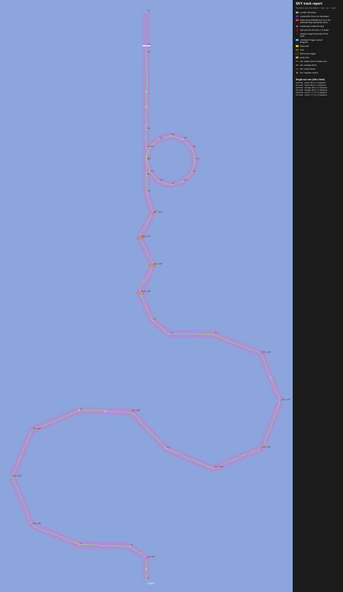

# SKY track report

Generated by `lune run tools/report.luau` from the real map builder, game modules and server scripts running in the offline mock engine. Re-run it after every map or balance change.

## Single-car race simulation

Each car drives alone with the shared Autopilot. "Authored" restores every part's authored collision. "Live code" runs MapVisibility and RaceProgress exactly as the server does; the two should match.

| Map | Car | Top speed | Driver | Result | Respawns | Wall hits |
|---|---|---|---|---|---|---|
| authored | slowest | 85.7 | expert | 86.9 s | 0 | 0 |
| live code | slowest | 85.7 | expert | 86.9 s | 0 | 0 |
| authored | slowest | 85.7 | average | 87.6 s | 0 | 0 |
| live code | slowest | 85.7 | average | 87.6 s | 0 | 0 |
| authored | slowest | 85.7 | novice | 111.9 s | 0 | 17 |
| live code | slowest | 85.7 | novice | 111.9 s | 0 | 17 |
| authored | p50 | 86.6 | expert | 85.5 s | 0 | 0 |
| live code | p50 | 86.6 | expert | 85.5 s | 0 | 0 |
| authored | p50 | 86.6 | average | 86.1 s | 0 | 0 |
| live code | p50 | 86.6 | average | 86.1 s | 0 | 0 |
| authored | p50 | 86.6 | novice | 118.5 s | 0 | 20 |
| live code | p50 | 86.6 | novice | 118.5 s | 0 | 20 |
| authored | fastest | 88.3 | expert | 82.8 s | 0 | 0 |
| live code | fastest | 88.3 | expert | 82.8 s | 0 | 0 |
| authored | fastest | 88.3 | average | 83.4 s | 0 | 0 |
| live code | fastest | 88.3 | average | 83.4 s | 0 | 0 |
| authored | fastest | 88.3 | novice | 104.0 s | 0 | 10 |
| live code | fastest | 88.3 | novice | 104.0 s | 0 | 10 |

Cars by top speed: slowest = Microwave + Hair Dryer + Pizza (top speed 85.7, turn 1.56 rad/s); p50 = Microwave + Kettle + Magnet (top speed 86.6, turn 1.54 rad/s); fastest = Kite + Cup Noodle + Trophy + Kite (top speed 88.3, turn 1.76 rad/s).

## Simulated matches (12 × 6 bots, authored map)

- Finish rate within 240 s: 100%
- Fastest car won 3 of 12 matches that had a finisher
- Rank correlation, top speed vs place: -0.20 (−1 = faster always places better)
- Rank correlation, rarity points collected vs place: -0.20

| Group | Mean place (1 = best) |
|---|---|
| farming: sweaty | 3.39 |
| farming: casual | 3.61 |
| driving: expert | 2.29 |
| driving: average | 2.71 |
| driving: novice | 5.50 |

## Fun metrics

Each simulated match is scored with `Shared/RaceMetrics` (the same code scores real Studio playtests, see `Modules/PlaytestReport`). Bots race as ghosts on one clock: no car-to-car contact, no abilities, so lead changes come from build and driving differences only. Targets are starting points in `Constants.FUN_TARGETS`; playtests decide.

| | Metric | Value | Target | Why |
|---|---|---|---|---|
| ✓ | closeShare | 0.57 | 0.25 ..  | the top two race each other a quarter of the time |
| ✓ | fastestWinRate | 0.25 |  .. 0.70 | the fastest build should not always win |
| ✓ | finishRate | 1.00 | 0.90 ..  | almost everyone finishes |
| ✓ | finishSpread | 25.52 |  .. 45.00 | nobody waits long for the last car |
| ✓ | leadChanges | 1.67 | 1.00 ..  | the lead changes at least once |
| ✗ | racingShare | 0.31 | 0.35 ..  | share of a round spent racing (vs farming / crafting / results) |
| ✓ | speedPlaceCorr | -0.20 | -0.60 .. 0.10 | the build helps a little; it must not decide the race |
| ✓ | winnerTime | 84.18 | 60.00 .. 120.00 | a race should take about 90 s |

Overtakes per match: 8.7. Per section (mean over matches; "decided" = matches whose largest time spread between bots was in that section):

| Section | Mean time (s) | Spread between bots (s) | Decided | Respawns | Wall hits |
|---|---|---|---|---|---|
| S1 launch tunnel | 8.8 | 2.7 | 0 | 0 | 40 |
| S2 cloud bend A | 16.4 | 3.7 | 0 | 0 | 91 |
| S3 crossover | 7.4 | 3.0 | 0 | 0 | 63 |
| S4 cloud bend B | 20.7 | 7.5 | 4 | 0 | 151 |
| S5 crystal canyon | 16.7 | 8.3 | 8 | 0 | 187 |
| S6 cloud corkscrew | 16.6 | 2.8 | 0 | 0 | 130 |
| S7 dive | 6.1 | 1.4 | 0 | 0 | 35 |

## Geometry findings

- 0 parts inside or next to the lane are solid during RACING but not in the authored map (red boxes).
- 0 decoration parts (^CrystalSpire_) stand inside the lane (red dots).
- 0 spots where a wall cuts more than 6 studs into the lane (pink rings).
- 0 of 157 sampled positions respawn off the track (pink ×).

## Known bugs from the test suite (0)

## What this does not cover

- Real Roblox physics: jumps, ramps, impulses, car-to-car contact. Confirm with the Studio RaceSim (`TestHarness.Runner.runRace`).
- Network latency, touch controls and whether it is fun. Those need people.
